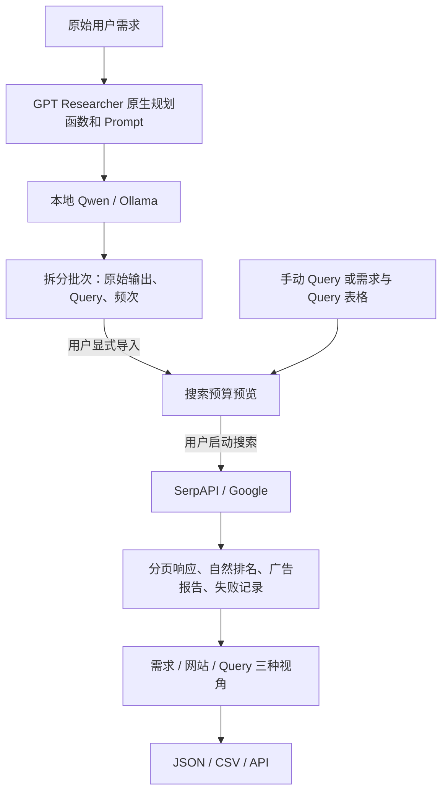

# GEO Search Agent Lab

用于 GEO / AIGEO 研究的本地实验工作台：研究用户的原始需求如何拆成搜索 Query，并观察这些 Query 在搜索引擎中返回的自然排名。

当前阶段为 **Phase 1 的查询规划与搜索观测部分**。本仓库包含独立源码快照，不包含原业务项目及其 Git 历史。

> 当前重点：A 拆分质量检查与 B 搜索排名观测。尚未实现完整 AI 回答、引用选择、真实平台批量测量，也未证明能复现 ChatGPT、Claude 或 Gemini 的内部搜索策略。

## 目录导航

- [功能与研究边界](#功能与研究边界)
- [架构与上游](#架构与上游)
- [安装和启动](#安装和启动windows-powershell)
- [使用流程](#使用流程)
- [统计与匹配口径](#统计与匹配口径)
- [API 与数据导出](#api-与数据导出)
- [数据保存与成本](#数据保存与成本)
- [验证与已知限制](#验证与已知限制)
- [常见问题](#常见问题)

## 功能与研究边界

| 模块 | 当前能力 | 边界 |
| --- | --- | --- |
| A 查询拆分 | 本地 Qwen 重复规划、按温度记录、原始输出与 Query 频次 | 频次不是语义质量评分 |
| B 搜索排名 | SerpAPI Google 搜索、预算预览、两页自然结果、原始响应证据 | 搜索无需先运行 A，不自动切换后端 |
| 结果概览 | 需求、Query、请求进度、返回条目、失败原因、网站命中、广告报告 | 只描述已观测样本 |
| 网站分析 | 指定域名、子域名、指定页面分别匹配 | 不自动分析页面正文或排名原因 |
| 导出与集成 | 批次 JSON、排名 CSV、Query 频次 CSV、只读查询 API | 暂不自动合并不同配置或批次 |
| 旧版实验模块 | 初搜快照、Planner 重放、离线评审工具保留 | 不作为新工作台必经步骤；不是完整 Agent 重放 |
| SearXNG | 固定镜像配置、localhost 部署脚本 | 尚未确立可用的实时引擎 baseline |

适合的研究问题包括：同一需求重复拆分是否稳定；不同温度生成了哪些 Query；指定网站在哪些 Query 的已采集结果中出现；搜索失败与未检出如何区分。

尚不能回答：某项 SEO 修改是否导致 AI 引用上升、网站为何排名靠前、真实 AI 平台内部使用了什么 Query，或本地结果与平台的统计等价性。

## 架构与上游



上游来自官方仓库，按完整 commit SHA 恢复，版本和许可证信息见 [upstreams.lock.json](upstreams.lock.json) 与 [上游版本说明](docs/upstream_versions.md)：

- GPT Researcher：主规划参考，固定版本 `0957c301ed06c2a5857b834358c7227c739041d4`。
- SearXNG：候选自建搜索层，保留基础设施配置。
- Qwen-Agent：后续对照参考，不参与当前工作台编排。

当前命名适配器为 `native-planner-direct-openai-v1`。保留固定版本的原生规划函数、Prompt 和 JSON 修复逻辑，但使用直接 OpenAI-compatible 传输，并阻止隐藏失败重试。因此这是明确记录差异的实验适配器，不能称为上游行为完全不变。

新工作台规划时初始搜索上下文为空，标记为 `empty_ablation`。模型调用不会隐式触发搜索；旧版带初搜上下文的实验与此配置应分开比较。

## 安装和启动（Windows PowerShell）

### 1. 前置条件

- Git、PowerShell、uv。
- Python 3.12.13：安装脚本通过 uv 创建隔离环境，并使用锁定依赖。
- 运行流程 A 需要 Ollama 和对应的 Qwen 模型；仅使用流程 B 不需要模型服务。
- 流程 B 需要自己的 SerpAPI 凭据及额度。
- Docker / Docker Compose 仅用于可选 SearXNG，不是新工作台的必需条件。

当前安装脚本和浏览器测试以 Windows 为主；Linux/macOS 和全新机器安装尚未完成验证。模型速度取决于可用 RAM、显存和运行后端，本仓库不承诺固定硬件性能。

### 2. 获取仓库和依赖

```powershell
git clone https://github.com/Freeman97376/geo-search-agent-lab.git
cd geo-search-agent-lab
powershell -NoProfile -ExecutionPolicy Bypass -File scripts/setup_lab.ps1
.\.venv\Scripts\python.exe scripts/restore_upstreams.py
```

私有仓库需要有访问权限的 GitHub 账号。上游恢复脚本仅从锁定的官方地址获取指定 SHA；现有 checkout 若被修改或版本不符，会报错并保留内容，不会直接覆盖。

### 3. 准备本地模型（流程 A）

安装并启动 Ollama 后：

```powershell
ollama pull qwen3:8b
powershell -NoProfile -ExecutionPolicy Bypass -File scripts/start_local_model.ps1
```

`pull` 会下载模型。模型标签可能随时间变化，下载相同名称不保证得到同一个 digest。当前锁定配置位于 [planner_local.json](geo_search_lab/config/planner_local.json)：

| 参数 | 当前值 |
| --- | --- |
| 模型 | `qwen3:8b` |
| 模型服务 | `http://127.0.0.1:11434/v1` |
| 固定 digest | `500a1f067a9f782620b40bee6f7b0c89e17ae61f686b92c24933e4ca4b2b8b41` |
| 工作台温度候选 | `0`、`0.4` |
| `top_p` | `1` |
| `max_tokens` | `2048` |
| `reasoning_effort` | `none` |
| `top_k` / seed | 未显式覆盖，使用服务端默认 |

模型 digest 不符时应恢复锁定版本，或把新版本作为新的实验配置记录；不要把它当成同一 baseline。启动脚本不会静默下载替代模型，也不会改写已运行服务的参数。

### 4. 启动新工作台

```powershell
.\.venv\Scripts\python.exe -X utf8 scripts/lab.py --store data/workbench/local serve --workspace --port 8766
```

打开 **http://127.0.0.1:8766/**。服务默认监听本机回环地址。终端按 `Ctrl+C` 停止；再次使用相同 `--store` 路径可以读取原有数据。

请保留 `--workspace`。旧 `scripts/start_lab.ps1` 对应早期工作台；`--offline` 对应旧版评审，与 `--workspace` 互斥。`.env.example` 是配置示例，不会自动加载。

### 5. 可选 SearXNG

```powershell
powershell -NoProfile -ExecutionPolicy Bypass -File scripts/start_searxng.ps1 -ValidateOnly
powershell -NoProfile -ExecutionPolicy Bypass -File scripts/start_searxng.ps1
```

需要正常运行的 Docker。配置监听 `127.0.0.1:8888`，镜像依据 `infra/searxng/images.lock.json`。启动 SearXNG 不会把新工作台的流程 B 自动切换到 SearXNG；当前 B 明确使用 SerpAPI。

## 使用流程

### 创建项目

填写项目名称和主要网站，例如 `example.com`。竞争网站和具体页面可选。主要网站应填写域名；完整页面 URL 放入页面列表。

### A：检查 Query 拆分

1. 输入一条或多条原始需求，多条之间留空行。
2. 选择重复次数和温度。默认每个温度重复 5 次；初次连通性检查可使用 1 次。
3. 启动拆分，查看逐轮状态、原始输出、有效 Query 和频次。
4. 需要搜索时，显式导入已结束且含成功输出的拆分批次。

示例需求（人为编写，仅用于说明输入形式）：

> 为美国食品加工厂采购工业离心泵，比较候选品牌的技术资料、当地售后服务和询价渠道。

可以检查输出是否覆盖技术选型、服务和询价等意图，但系统不会自动把这些判定为已覆盖，也不规定每轮必须生成相同数量或措辞的 Query。

### B：观察搜索排名

1. 在界面配置 SerpAPI 密钥。保存密钥本身不会调用搜索。
2. 手动输入 Query，每行一条；或从 A 导入。也可粘贴两列 Tab 分隔文本：`原始需求`、`Query`，保留需求分组。
3. 设置地区、语言、定位、设备和 Google 域名。默认 `us / en / desktop / google.com`。
4. 点击预算预览。当前按每个独立 Query 两页估算，默认上限 10 次请求，即最多 5 条独立 Query。
5. 确认界面中实际请求规模后启动，查看持续更新的概览和明细。
6. 下载 CSV 或完整 JSON；更新网站目标会对现有结果重新匹配，不会额外搜索。

## 统计与匹配口径

### 三种分析视角

- **原始需求**：汇总需求对应的 Query 和结果，供检查覆盖情况；语义覆盖率当前未评定。
- **网站**：观察指定网站、子域名和页面的检出位置。
- **Query**：查看具体结果、来源网站与失败状态，为后续人工研究排名因素提供入口。

### Query 次数

在同一原始需求内按**完全相同的 Query 文本**聚合，不合并大小写、空格变化或同义改写。

| 字段 | 含义 |
| --- | --- |
| `occurrence_count` | 所有有效输出中出现的次数，包含同一轮内部重复 |
| `trial_count` | 出现过该 Query 的有效轮数，每轮最多计一次 |
| `valid_trials` | 对应需求的有效轮数，不把失败当有效样本 |
| `temperature_counts` | 按温度分组的计数 |
| `origins` | 逐轮来源，用于追溯 |

搜索侧相同 Query 与设置在同一批中合并以节省请求，但保留来源映射。10 次生成引用同一份搜索快照，不等于独立搜索采样了 10 次。

### 域名与页面

当目标为 `example.com` 时：

| 返回 host | 分类 |
| --- | --- |
| `example.com` | 指定域名 |
| `www.example.com`、`shop.example.com` | 子域名 |
| `notexample.com`、`example.com.evil.com` | 不匹配 |

域名输入保留 `www`。如果目标填写 `www.example.com`，精确匹配基于这个 host。指定页面使用独立 URL 规范化规则：去 fragment、utm 参数及 www，保留协议、路径与业务参数。原始 URL 不被覆盖。

API 保留含子域名的兼容字段 `best_rank`，并分别提供 `exact_domain_best_rank`、`subdomain_best_rank`、`exact_page_best_rank`。同一 Query 可以同时命中两类 host，不能简单相加作为独立 Query 数。

### 排名、缺失和广告

- 自然结果按 provider 返回顺序展示，不进行自定义 GEO 排序。
- `observed_rank = page_start + index`，index 从 1 开始；原始位置单独保存在 `provider_position`。
- 短页不压缩排名空位。两页成功但只返回 19 条，与完整 20 条是不同状态。
- 未开始、失败无响应、成功空结果、部分结果分别记录。缺失排名为 `null`，不是 0。
- 检出比例只使用实际观测到自然条目的独立 Query 作为相应分母，同时保留总数和完整性信息；不能代表全部计划 Query 或整个市场。
- Sponsored 由成功响应中的 `ads` 区块单独报告，不计入自然排名。未报告广告不等于浏览器中一定没有广告。
- 两页是不同时间的请求，不是原子快照；不同地区、语言、设备、时间或批次不自动混合。

## API 与数据导出

接口前缀为 `/api/v1/workspace`。写请求需要 `X-Lab-Request: 1`；浏览器写请求受同源限制。

| 方法与路径 | 用途 |
| --- | --- |
| `GET /status` | 工作台能力与密钥配置状态，不返回密钥 |
| `PUT /serpapi-key` | 设置服务内存中的密钥 |
| `GET /projects` | 项目索引 |
| `POST /projects`、`PUT /projects/{id}` | 创建或更新项目 |
| `POST /planning` | 创建拆分批次 |
| `POST /search/preview` | 去重和预算预览，不调用搜索 |
| `POST /search` | 创建搜索批次 |
| `GET /batches`、`GET /batches/{id}` | 批次索引及详细结果 |
| `POST /batches/{id}/cancel` | 停止后续派发，保留已完成记录 |
| `GET /batches/{id}/export?format=json` | 完整结果、概览与来源信息 |
| `GET /batches/{id}/export?format=csv` | 平面排名或逐轮拆分表 |
| `GET /batches/{id}/export?format=query_csv` | 拆分 Query 频次表 |

只读示例：

```powershell
Invoke-RestMethod http://127.0.0.1:8766/api/v1/workspace/status
Invoke-RestMethod http://127.0.0.1:8766/api/v1/workspace/batches
```

JSON 适合保留完整来源关系，CSV 适合表格查看；CSV 对可能被表格软件解释为公式的文本作转义。未来集成可使用项目、需求、Query、批次及 cohort 标识关联，不能仅按 Query 文本盲目合并历史。

创建批次接口目前没有跨重试幂等保证。如果 POST 超时，应先查询批次状态，避免重复提交产生额外调用。

## 数据保存与成本

使用上述启动命令时：

```text
data/workbench/local/
└── workspace/
    ├── workspace.sqlite3
    └── artifacts/{batch_id}/
```

数据库保存任务和请求账本，artifacts 保存可追溯证据。备份时先停止服务，再整体复制所用 store 目录，避免只复制运行中的单个 SQLite 文件。

密钥由界面保存在服务内存中，重启需要重新输入；也支持进程环境变量 `SERPAPI_API_KEY`。导出不回显密钥，响应证据如需脱敏会分别记录原始与落盘 hash。模型消息和搜索结果本身可能包含业务内容，应按自己的数据管理要求保存。

每个搜索请求在派发前预留本地请求计数。失败不会自动退回计数，进程中断后的未知状态不会自动重试或续跑。该计数是本地预算保护，**不是 SerpAPI 的实际扣费账单**。预览、读取结果、重新匹配网站不会调用搜索；下载依赖和模型仍会使用网络与磁盘。

## 源码结构

```text
geo_search_lab/
  workspace/          # 新工作台的数据契约、队列、搜索与统计
  workbench/          # FastAPI 应用与静态界面
  research/           # 旧版离线评审
  adapters/           # 上游与初搜适配
  logging/            # 请求证据与模型传输记录
  replay/             # 早期 Planner 重放
  evaluation/         # 评估工具
  config/             # 本地模型配置
infra/searxng/        # 可选搜索基础设施
scripts/             # 安装、启动、上游恢复及实验入口
tests/               # 原生自动化测试
data/benchmarks/     # 编写的测试需求示例
docs/                # 架构和详细设计
office/              # 协作规范及验证记录
upstreams.lock.json  # 官方上游版本锁
requirements-upstream.lock.txt
```

## 验证与已知限制

恢复上游和安装依赖后，可在仓库根目录运行：

```powershell
.\.venv\Scripts\python.exe -X utf8 -m unittest discover -s tests -p test_workspace.py -v
.\.venv\Scripts\python.exe -X utf8 -m unittest discover -s tests -v
powershell -NoProfile -ExecutionPolicy Bypass -File office/scripts/Test-OfficeGovernance.ps1
```

浏览器测试另外依赖 Node.js、可解析的 `playwright` 包和 Chromium，并要求本仓库内存在 `.venv/Scripts/python.exe`：

```powershell
node --test tests/test_workspace_browser.cjs
```

如使用自定义浏览器位置，可设置 `PLAYWRIGHT_CHROMIUM_EXECUTABLE`。浏览器测试使用本地模拟服务，不调用真实搜索。

独立导出阶段验证：**20 项工作台测试通过，Office 治理结构与自测通过**。测试复用了原机器的 Python 环境和固定上游副本；没有重新执行全新依赖安装、完整测试集或浏览器测试，也没有消耗付费模型或搜索额度。

当前已知边界：

- SerpAPI 单请求超时为 45 秒；慢响应可能使批次提前停止。
- 暂无自动重试、失败续跑和跨批自动合并。
- 还没有真实 AI 平台的批量对照、统计置信区间或因果效果验证。
- 温度为 0 也不能承诺不同硬件、服务版本或时间下输出绝对相同。
- 没有自动正文抓取、答案生成、引用选择和完整 Agent 重放。
- 本地工作台不是带多用户认证的公网服务，不应直接暴露到公网。

## 常见问题

**为什么显示 `stopped_without_retry`？**

这是批次在请求失败后停止且不自动重试的标记。应查看该批的具体错误和请求账本，例如超时、响应设置不一致等。已有结果会保留；不能把没有返回的 Query 当成没有搜索结果。

**为什么搜索结果与浏览器不同？**

先比较时间、地区、语言、定位、设备、Google 域名，以及自然结果和广告的分类。共享旧快照也不代表新一轮实时搜索。没有这些条件一致的证据，不能直接判断某一侧错误。

**为什么模型启动提示 digest 不一致？**

仓库锁定的是具体模型内容；同名标签的新下载版本可能不同。恢复固定模型或建立新的命名实验配置，记录差异后再比较。

**为什么第一次测试提示缺少 GPT Researcher？**

第三方代码没有上传到仓库；先运行 `scripts/restore_upstreams.py`，确认上游 SHA 与 clean checkout 检查通过。

**为什么仓库没有以前的实验结果？**

本次上传只包含源码和编写的示例。真实需求记录、搜索快照、数据库、环境报告、生成表格和模型权重保留在原机器。历史文档中提到的验证 JSON 和批次属于原工作区证据，未随本仓库发布，不应作为当前安装已验证的证明。

## 文档、版本与许可

- [独立工作台详细说明](docs/independent_workspace.md)
- [固定版本 GPT Researcher 架构](docs/gpt_researcher_architecture.md)
- [Query 评估协议](docs/query_evaluation_protocol.md)
- [真实平台差距评估设计](docs/platform_gap_evaluation.md)
- [上游版本和许可](docs/upstream_versions.md)

本仓库为私有研究项目，尚未为自有代码指定开源许可证。上游许可证仅适用于各上游项目，不自动覆盖本项目。第三方代码通过锁文件独立恢复，不将其源码副本、模型权重或原父仓库历史纳入此仓库。
