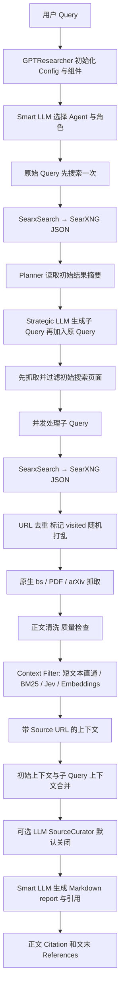

# GPT Researcher 实际代码架构审计

审计 checkout：`0957c301ed06c2a5857b834358c7227c739041d4`，`main`，源码版本 `0.16.0`。本文件依据本地 Python 实现逐项阅读，不把 README 示意图当作执行路径。**这是静态代码审计；尚未完成本机 Query → Citation 端到端运行。** 除 `backend/` 开头的路径相对 `third_party/gpt-researcher/` 外，表中其他代码路径相对 `third_party/gpt-researcher/gpt_researcher/`。本次没有修改该仓库。

## 执行范围与真实数据流

首个实验建议使用库入口 `GPTResearcher(query, report_type="research_report", report_source="web")`，然后依次调用 `conduct_research()` 和 `write_report()`。这保留标准研究路径，并避免 UI、深度研究、多 Agent 和 MCP 同时成为变量。该选择待 baseline 确认。

这不是简单的一条直线：LLM 在角色选择和 Query Planning 阶段就已经参与；Planner 前存在搜索；标准路径的引用与报告在同一次 LLM 生成中产生，没有独立的 Citation Selection Agent。

## 逐步入口、输入、输出和默认值

| 步骤 | 文件、类、函数（行号） | 输入 → 输出 | 当前上游默认 / 实际行为 |
| --- | --- | --- | --- |
| 1 用户 Query | `agent.py:53` `GPTResearcher.__init__` | query 字符串、配置、可选 sources → researcher 对象 | `research_report`、`web`、Markdown、Objective；库参数 `verbose=True` |
| 2 HTTP/UI 入口 | `backend/server/app.py:372` `generate_report`；`:333` `write_report`；`:409` `websocket_endpoint` | `ResearchRequest` / WS start 消息 → 后台研究调用 | WS 经 `server_utils.handle_start_command`、`websocket_manager.run_agent`；本实验不要求启动 UI |
| 3 创建研究对象 | `backend/report_type/basic_report/basic_report.py:10` `BasicReport.__init__` / `run`；`agent.py:170` 起的组件创建 | Query、headers、config → ResearchConductor / ContextManager / BrowserManager / ReportGenerator / SourceCurator | DeepResearchSkill 仅 `deep` 分支；本报告审计标准 web 路径 |
| 4 配置加载 | `config/config.py:35` `Config.__init__`，`:63` `_set_attributes`，`:158` `load_config` | DEFAULT_CONFIG + JSON + 环境变量 → cfg 属性 | 环境变量覆盖 JSON；旧变量也能覆盖模型配置；headers 还能覆盖 retriever |
| 5 Agent 角色 | `agent.py:343` `conduct_research`；`actions/agent_creator.py:18` `choose_agent` | Query、角色提示 → `{server, agent_role_prompt}` 解析结果 | Smart LLM，温度 0.15；json_repair；解析/调用失败有角色恢复逻辑 |
| 6 Planner 前搜索 | `skills/researcher.py:50` `_get_initial_search_results`；`actions/query_processing.py:44` `get_search_results` | 原 Query → 第一 retriever 的结果列表 | 只用 `retrievers[0]`；上限 `MAX_SEARCH_RESULTS_PER_QUERY=5`；阻塞 search 在线程中执行 |
| 7 Planner | `skills/researcher.py:68` `plan_research`；`actions/query_processing.py:158` `plan_research_outline` | Query、初始结果、父 Query、report_type → 子 Query 列表 | 标准研究没有单独 Planner 类；MCP-only 可以跳过生成 |
| 8 Query Rewrite | `actions/query_processing.py:83` `generate_sub_queries`、`:13` `_normalize_sub_queries`；`prompts.py:213` `generate_search_queries_prompt` | 规划提示、初始摘要 → `list[str]` | 请求 `MAX_ITERATIONS=3` 个子 Query；json_repair 及结构归一；非 subtopic 追加原 Query；不是严格最大搜索次数 |
| 9 Provider interface | `actions/retriever.py:16` `get_retriever`、`:150` `get_retrievers`；`retrievers/base.py` `BaseRetriever` | 名称 → 可构造的 retriever 类；`search(max_results=...)` → dict 列表 | Duck typing；SearxSearch 并不继承 BaseRetriever。默认 Tavily，显式 SearX 名称为 `searx` |
| 10 SearXNG adapter | `retrievers/searx/searx.py:25` `SearxSearch`、`:60` `search` | Query → GET `SEARX_URL/search?q=...&format=json` → `[{href, body}]` | timeout 20 秒；直接调用 search 默认 10 条，标准研究传入 5；`query_domains` 尚未实现；不传 language / engines |
| 11 原始搜索结构 | SearXNG `/search` JSON；上述 `SearxSearch.search` | `results[]` 含 url/content/engine/engines/positions/score 等 → 只保留 href/body | body 截断至 100 字符；title/rank/engine 等丢弃；`requires_scraping=True`；API 原始字段必须另存 |
| 12 URL 筛选 | `skills/researcher.py:851` `_search_relevant_source_urls`、`:813` `_get_new_urls` | retriever 结果 → 未访问 URL 列表、prefetched 内容列表 | 跳过无 URL、按 URL 字符串去重；先写 visited 再抓取；`:932` `random.shuffle`；没有额外 GEO 排序 |
| 13 初始结果读取 | `skills/researcher.py:836` `_get_context_from_initial_results`，`:298` `_get_context_by_web_search` | 初始 results → 页面内容与过滤上下文 | 先读取初始页面，再 `asyncio.gather` 子 Query；最终按 initial_context、子 Query 顺序合并为字符串 |
| 14 网页抓取 | `skills/browser.py:37` `BrowserManager.browse_urls` → `actions/web_scraping.py:12` `scrape_urls` → `scraper/scraper.py:142` `Scraper.run` / `:194` `extract_data_from_url` | URL 列表 → `{url, raw_content, image_urls, title}` 列表 | `SCRAPER=bs`，15 workers，rate delay 0；PDF、arXiv 按 URL 路由；拒绝不安全 URL；失败行被过滤 |
| 15 HTML 读取清洗 | `scraper/beautiful_soup/beautiful_soup.py:21` `BeautifulSoupScraper.scrape` / `:58` `_fetch`；`scraper/utils.py:123` `clean_soup` / `:219` `get_text_from_soup` | HTTP bytes → BeautifulSoup(lxml) → 正文、图片、title | GET 10 秒；暂时性错误重试一次；去除 script/style/header/footer/nav 等；保留块级文本再整理空白；不自动换 Crawl4AI |
| 16 内容质量门槛 | `scraper/scraper.py:194` `extract_data_from_url`、`:276` `_reject`、`:284` `_retry_as_pdf` | 抓取文本 → 合格正文或失败 | 小于 100 字符、反机器人页、疑似词表被拒绝；疑似未解析 PDF 用 PyMuPDF 重试；非无条件浏览器 fallback |
| 17 context 入口 | `skills/context_manager.py:38` `get_similar_content_by_query` → `context/select.py:53` `select_context` | sub_query、pages → 带 URL 的 context 字符串 | `max_results=10`；总正文 <8000 字符且页数≤10 时直通；`none` 也先通过 Document 转换 |
| 18 chunk 与排序 | `context/retriever.py:16` `SearchAPIRetriever`；`context/lexical.py:69` `LexicalContextCompressor`，`:95` `select` | 每页正文 → chunks → 选中 chunks | 每页截到 50000 字符；chunk 1000 / overlap 100；BM25 k1=1.5、b=0.75；保留≥最高分 0.5 且最多 25 块；无关键词重叠取开头块 |
| 19 其他过滤路线 | `context/select.py:38` `resolve_context_filter`；`context/jev_filter.py` `JevContextCompressor`；`context/compression.py:85` `ContextCompressor` | Query、chunks → 相关 chunks | auto 有 `TYPESAFE_API_KEY` 用 Jev，否则 keyword；embedding 路线阈值 cfg=0.42；失败回退 keyword；并非必定使用 embedding |
| 20 Source 排序 | `skills/researcher.py:211` 处 curate 开关；`skills/curator.py:38` `SourceCurator.curate_sources` | 研究上下文 → LLM 选择的来源/内容 | 默认 `CURATE_SOURCES=False`；开启时 Smart LLM，温度 0.2、8000 tokens；失败返还原始输入 |
| 21 送入 LLM 的 sources | `prompts.py:555` `pretty_print_docs`；`skills/writer.py:49` `ReportGenerator.write_report` | 选中的 Document metadata.source + page_content → 最终 context | 不是所有搜索结果，也不是 visited_urls；空 context 明确弃答，不应当计作成功的 baseline |
| 22 报告生成 | `agent.py:463` `write_report` → `skills/writer.py:49` → `actions/report_generation.py:209` `generate_report` | 角色 system prompt + 包含 context 的 user prompt → report 字符串 | Smart LLM；温度硬编码 0.35；stream=True；SMART_TOKEN_LIMIT=12000；失败合并 system/user 再试，仍失败可能返回空串 |
| 23 Citation 生成 | `prompts.py:262` `generate_report_prompt` | 报告提示中的 Source URL → LLM 输出内联 Markdown citation + references | 要求仅引已提供来源、APA 风格，但没有逐条验证事实支持或独立引用选择器 |
| 24 Citation/source tracking | `agent.py` `get_source_urls` / `get_research_sources`；`actions/markdown_processing.py:101` `add_references` | visited set / 成功抓取 sources / report 文本 → 不同集合 | add_references 仅把排序后的 visited URLs 附到报告，标准 BasicReport.run 未调用它；不能用 visited 当作实际 Citation |
| 25 LLM API | `utils/llm.py` `create_chat_completion` → `llm_provider/generic/base.py:146` `GenericLLMProvider.from_provider` | 模型、messages、kwargs → LangChain completion | `openai` 分支接受 `OPENAI_BASE_URL`，可指向本地兼容接口；FAST、SMART、STRATEGIC 都需显式设置 |

行号用于此固定提交；更新上游时必须重新生成核对，不能直接沿用本表。

## 默认配置快照

原始依据：`gpt_researcher/config/variables/default.py`，机器可读副本见 `upstream_defaults.json`。

| 设置 | 上游默认 | 实验建议 / 当前状态 |
| --- | --- | --- |
| RETRIEVER | tavily | 明确 `searx`，启动时断言实际类只有 SearxSearch |
| FAST / SMART / STRATEGIC | openai:gpt-5.4-mini / openai:gpt-5.4 / openai:gpt-5.4 | 草案均设为现有 `openai:qwen3:8b`；未运行验证 |
| EMBEDDING | openai:text-embedding-3-small | 标准 keyword 路线不会构造 embedding；非标准路径仍需另审 |
| CONTEXT_FILTER | auto | 草案固定 keyword，等价于无 TypeSafe key 的默认分支 |
| CURATE_SOURCES | false | 保持关闭 |
| SCRAPER | bs | 保持原生 bs / PDF / arXiv |
| MAX_SEARCH_RESULTS_PER_QUERY / MAX_ITERATIONS | 5 / 3 | 保持；重复原 Query 和初始搜索仍会产生额外调用 |
| FAST / SMART / STRATEGIC TOKEN LIMIT | 6000 / 12000 / 8000 | 本地 8B 的 context 和输出预算需要验证；不可静默缩减 |
| TEMPERATURE | 0.4 | 角色选择 0.15、报告 0.35、curator 0.2 在调用点覆盖；不能只记录 cfg.temperature |
| LANGUAGE / TOTAL_WORDS / REPORT_FORMAT | english / 1200 / APA | 搜索语言与报告语言是两个变量；用户语言范围尚待确认 |
| MCP_STRATEGY / IMAGE_GENERATION_ENABLED | fast / false | 草案禁用 MCP、保持图片生成关闭；提取已有页面图片仍可能发生 |

## 会改变实验含义的隐式行为

1. **搜索 provider fallback**：`Config._set_attributes` 对非法 RETRIEVER 回退 Tavily；`get_retrievers` 对未知名称、空列表再次回退 Tavily；请求 headers 优先于 cfg。标准 SearX 请求失败不会主动改成另一个 provider，而是报错或被上层捕获成空内容。不能混淆配置 fallback 与运行时 fallback。
2. **LLM fallback**：Query Planning 先 Strategic，再带 token limit 重试，再 Smart。三个角色都指向同一本地模型才能避免意外外部模型调用。报告失败也会改变 message 形状重试；日志需记录每次尝试。
3. **过滤 fallback**：auto 由环境变量决定；Jev 使用外部 TypeSafe 服务；embedding 初始化或调用失败会退到 keyword。实际过滤模式必须记入运行日志。
4. **原始 rank 不等于正文顺序**：SearXNG 自己会融合不同 engine 的结果，JSON 的数组序号才是 aggregate rank；positions 是引擎排名信息（仅在返回时保留，不补造）。GPT Researcher 之后随机打乱 URL，并按 BM25 重排 chunks。这些是上游行为，Phase 1 不应删除。
5. **中文风险**：上游 BM25 用 Unicode `\w+` 和英文停用词/词尾处理，没有中文分词；无空格中文匹配可能很弱。第一轮应记录现象，不替换分词器来美化 baseline。
6. **source 不等于 citation**：`visited_urls` 包含尝试抓取但失败的 URL；`research_sources` 主要是成功抓取结果；context 只是部分页面/chunks；最终引用由 LLM 决定，可能遗漏、拼错或引用未提供 URL。至少需要四份集合及它们的对应关系。
7. **原生日志不完整**：`agent._log_event`、`utils/logging_config.py`、WebSocket `CustomLogsHandler` 有阶段信息；可选 `ChatLogger` 有模型 messages/response，但不是完整 HTTP、抓取正文、chunk 分数、citation 映射和可重放快照。
8. **可重现边界**：固定源 SHA 只固定代码。日期提示、搜索时间、页面变化、LLM 采样、model digest、依赖解析、随机 shuffle、并发时的 URL 去重归属都会影响结果；需要分别记录和定义回放层次。

## 下一阶段的日志接入边界（尚未实施完整链路）

| 边界 | 必存信息 | 当前状态 |
| --- | --- | --- |
| 原 Query / run manifest | run_id、Query、时间、源码 SHA、有效配置、环境 allowlist、seed、模型/镜像 digest | 版本和环境已记录；统一运行器待实现 |
| 每次 SearXNG HTTP 请求 | 完整 query 参数、原始响应 bytes、HTTP 状态、headers、耗时、unresponsive_engines、数组 rank | `search_capture.py` 可用于独立探测；还未接入 GPT Researcher |
| Planner / LLM | 每次 messages、模型参数、重试、返回内容、token usage、耗时 | 待实现 |
| URL / crawler | 候选顺序、去重原因、shuffle 后顺序、请求与最终 URL、状态、原 HTML/PDF、清洗正文 hash | 待实现 |
| context selection | 过滤分支、每个 chunk 的 URL/offset/hash/分数、保留/丢弃原因、精确最终 context | 待实现 |
| report / citation | Markdown 原文、正文引用、references、citation→context→page→search result 映射、无法对应项 | 待实现；匹配 URL 不等于事实支持验证 |

建议之后把 transport 记录及运行包装层放在 `geo_search_lab/`，先使用上游现有接口。任何必须插入的 hook 都需单独列出行为影响、契约测试和 before/after；不要直接在 third_party 中改算法。

Replay 至少要区分：①完全离线重放所有已记录响应，用于检查日志和调度；②固定搜索/网页/Query plan，再调用本地 LLM 的消融回测。第二种不是字节级确定性回放。快照缺失应明确失败，不能偷偷 Live Search。这些边界待用户确认，当前没有宣称已完成 Replay。
